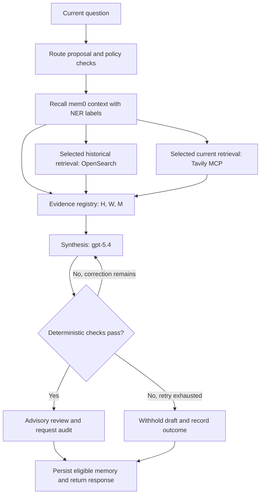

# Exercise 3: Agentic RAG + MCP + Memory

**Workshop:** Cognitive Memory Architectures: Designing Continuity into Long-Running RAG and Agentic Solutions  
**Section 3 of 4: Suggested time: 20 minutes**

In this exercise, you will run a News Agent that combines historical articles in OpenSearch, current news retrieved through a Tavily MCP tool, and persistent context in mem0. You will inspect named entity recognition, ingest the news corpus, ask two research questions, and then restart the agent to see whether it can recover a preference from an earlier interaction.

The central question is: **Can the agent use new evidence while remembering what matters to this user?**

## What changes when RAG becomes agentic?

A conventional RAG pipeline usually follows a predefined sequence: retrieve documents, assemble a prompt, and generate an answer. This implementation adds an orchestration call that proposes which external evidence sources to use, followed by synthesis and a bounded verification-and-correction cycle. Python policy checks constrain those decisions.

The workshop uses two model roles:

| Role | Workshop model | Responsibility |
| --- | --- | --- |
| Orchestration | OpenAI `gpt-5.4` | Propose historical OpenSearch retrieval, current Tavily MCP retrieval, or both; also provide an advisory review of the resulting draft. |
| Synthesis | OpenAI `gpt-5.4` | Write an answer from the supplied external evidence and recalled memory, with citations. |

The roles have separate prompts and calls. In a larger design, using different models for orchestration/review and synthesis is worth evaluating to reduce shared blind spots. Asking the same model to grade its own homework can reproduce the same mistake. Different models still need evidence checks and evaluation; model diversity does not guarantee a correct answer. If you are looking at a propper implementation of these two model roles, I would invite you to take a look at the slides/demo for my session at [API World 2026](https://github.com/davidvonthenen/2026-api-world).

**mem0 supplies continuity.** It preserves prior conversation, extracted context, and archived news evidence so a later answer can account for earlier work. In this version, routing happens **before** memory recall: remembered context influences synthesis and review, while application code manages memory reads and writes. The correction loop can revise the answer using the same evidence; it does not run another retrieval round.

This exercise follows the supplied implementation: OpenSearch holds the historical corpus, and mem0 provides memory. The active configuration selects `gpt-5.4` for both model roles. See [configuration](src/common/config.py) and the [agent request flow](src/news_agent/news_agent.py).

## Work from the exercise directory

Run every command from the directory containing `client.py`, `ner_server.py`, and `src/`, using the Python environment prepared during attendee setup. OpenSearch, mem0, Tavily credentials, and OpenAI configuration are already available.

Open four terminals in that directory:

| Terminal | Use | Default service address |
| --- | --- | --- |
| A | NER server | `http://127.0.0.1:8000/ner` |
| B | Tavily MCP server | `http://127.0.0.1:8765/mcp` |
| C | News Agent | `http://127.0.0.1:9001/v1/chat/completions` |
| D | Ingestion, client commands, and audit inspection | Calls the services above |

Leave each server running in its terminal. Run client requests one at a time and wait for each response before continuing. Keep the configured memory user and session unchanged through the main exercise.

## 1. Ingest the historical news corpus

**Terminal D**

Place the workshop-provided `ai_media_dataset_20250911-1000lines.csv` beside `client.py`. The code archive does not include this CSV, so use the dataset supplied with the workshop materials.

Run:

```bash
python -m src.ingest
```

Run the command that matches your dataset location. Ingestion prepares the historical evidence the agent will retrieve later; it does not populate conversation memory.

### What ingestion does

1. **Read and normalize articles.** The loader reads the CSV's `title` and `content` columns, joins paragraph lists into article text, and retains available metadata such as URL, publication date, domain, tags, and the original CSV row. Empty article content is skipped.
2. **Split each article into overlapping chunks.** The default window is **2,048 characters**, with **256 characters of overlap**. The next window starts 1,792 characters after the previous one. These are character counts; the splitter does not align windows to sentence boundaries.
3. **Create embedding inputs.** Each chunk is combined with the article title and available date, domain, and tags before embedding. The stored source excerpt remains the article text, so a cited passage can be traced back to its article.
4. **Generate vectors.** The configured embedding component converts those inputs into numerical representations used for semantic similarity search.
5. **Store vectors and provenance in OpenSearch.** The default index is `techcomp-vector-chunks`, unless your workshop configuration overrides it. Its `embedding` field uses `knn_vector`; each indexed chunk also retains its source identifiers, position, text, and metadata.
6. **Refresh the index.** The command writes batches of 16 chunks by default and refreshes the index so the new corpus can be searched.

Why overlap? A sentence near a chunk boundary may name a product while the next sentence explains its significance. Repeating 256 characters gives neighboring chunks shared context, at the cost of embedding and storing some repeated text.

For a sufficiently long article, the first windows are:

| Chunk | Character slice | Shared context |
| --- | --- | --- |
| First | `text[0:2048]` | Initial window |
| Second | `text[1792:3840]` | Repeats the previous window's final 256 characters |
| Third | `text[3584:5632]` | Repeats the second window's final 256 characters |

The final window can be shorter. One article can produce several chunks, so the chunk count may exceed the article count.

### Observe the result

Watch for the `Indexing` progress indicator and a final line with this structure:

```text
Ingested <articles> articles as <chunks> chunks into 'techcomp-vector-chunks' (dataset_id=ai_media_dataset_20250911-1000lines.csv).
```

Record your article and chunk counts. Their values depend on the actual dataset.

Re-running ingestion replaces the chunks associated with this dataset's identifier, which defaults to the CSV filename. Other dataset identifiers remain in the index. One completed ingestion is sufficient for this exercise.

Implementation: [CSV loading, chunking, and ingestion](src/ingest.py), [embeddings](src/common/embeddings.py), and [OpenSearch indexing](src/common/opensearch_client.py).

## 2. Start the named entity recognition server

**Terminal A**

**Named entity recognition (NER)** identifies spans of text representing entities such as organizations, people, places, and products, and assigns category labels. For example, an extractor might label `Google` as `ORG` and `California` as `GPE`, a geopolitical entity. These are predictions, so the exact output depends on the text and model. See the [spaCy NER explanation](https://spacy.io/usage/linguistic-features#named-entities).

This service uses spaCy's `en_core_web_sm` pipeline. If its language model was not installed during attendee setup, install it once:

```bash
python -m spacy download en_core_web_sm
```

Start the server:

```bash
python ner_server.py
```

Wait for the server to report that it is listening on port `8000`, then leave it running.

The News Agent calls this service when reading and writing memory. Labels such as `ORG:google` help it prefer relevant memories about the same entities. NER adds topic metadata; it does not establish whether a news claim is true.

Implementation: [NER server](ner_server.py) and [entity labeling in the conversation manager](src/common/conversation.py).

## 3. Start the Tavily MCP server

**Terminal B**

**REMINDER:** If you are using a virtual environment like `venv`, `miniconda`, `uv`, etc, don't forget to initalize it for this console!

```bash
python -m src.tavily_mcp_server
```

Leave it running on the configured MCP endpoint, defaulting to `http://127.0.0.1:8765/mcp`.

**Model Context Protocol (MCP)** provides the tool interface between the News Agent and this server. The server exposes `search_technology_news(question: str)` over Streamable HTTP. When the agent's route includes current news, its MCP client calls this tool with the incoming question; the server uses Tavily to retrieve news and returns structured results. See the [MCP tools specification](https://modelcontextprotocol.io/specification/2026-07-28/server/tools).

The returned data includes source titles, URLs, excerpts, scores, publication dates when available, and a retrieval timestamp. The default search requests up to three results. This evidence lets the agent supplement the previously ingested corpus with information retrieved during the current request.

Keep the responsibilities distinct: MCP carries the tool call, Tavily supplies search results, and the News Agent evaluates and cites the evidence in its answer.

Implementation: [MCP server](src/tavily_mcp_server.py), [agent MCP client](src/news_agent/mcp_news.py), and [Tavily search wrapper](src/common/tavily_client.py).

## 4. Start the Agentic News Agent

**Terminal C**

**REMINDER:** If you are using a virtual environment like `venv`, `miniconda`, `uv`, etc, don't forget to initalize it for this console!

```bash
python -m src.news_agent
```

Leave the server running. The client will send requests to its Chat Completions endpoint at `http://127.0.0.1:9001/v1/chat/completions` by default.

For a supported news question, the main flow is:



Only selected external retrieval paths run. When both are selected, OpenSearch and Tavily retrieval run concurrently. Recalled memory joins their results in the evidence registry.

The application checks for unknown citation IDs, missing valid inline citations, and specified financial-domain violations. By default, a generation error or failed deterministic check allows **one additional synthesis attempt**. Model review is advisory: its concerns alone do not block an answer that passed the deterministic checks. These checks do not prove that every cited claim is correct; you will inspect the supporting evidence yourself.

After auditing an eligible response, the agent saves memory. A completed answer adds the conversation turn and submits it for memory inference. A withheld draft is not stored as a completed conversation turn, although retrieved web evidence can still be archived.

Implementation: [agent loop](src/news_agent/news_agent.py), [citation and domain checks](src/news_agent/governance.py), and [memory integration](src/news_agent/memory.py).

## 5. Ask the two Google AI questions

**Terminal D**

### First: investigate current work

```bash
python -m src.query --question "What is Google currently working on in Artificial Intelligence (AI)?"
```

Wait for the answer. Read its claims and Sources section together.

| Citation prefix | Meaning in this request |
| --- | --- |
| `[H#]` | Historical article chunks retrieved from OpenSearch. |
| `[W#]` | Fresh news evidence returned through Tavily MCP. |
| `[M#]` | Recalled mem0 content: prior turns, inferred context, or archived web evidence. |

Your first request may have no memory citations if this News Agent's memory scope is new. The answer also includes an Audit ID that connects it to its execution record.

In Terminal C, look for retrieval messages such as `event=historical_retrieval` and `event=mcp_news_retrieval`, followed by audit and completion events. In Terminal A, notice the NER requests made during memory processing.

### Second: investigate a specific period

```bash
python -m src.query --question "What announcements has Google made in Artificial Intelligence (AI) in October 2026?"
```

Compare this answer with the first:

1. Which statements have historical, fresh web, or memory citations?
2. Do the cited publication dates support an October 2026 claim?
3. Does the answer distinguish an announcement date from the date the source was retrieved?
4. Does it explain gaps when the available evidence cannot establish an announcement?

With the shipped policy, both of these exact questions select historical and current retrieval. They demonstrate combining evidence and changing the requested time frame; they are not a guaranteed switch between two exclusive routes.

**The calendar detail matters:** this wrapper does not translate `October 2026` into exact start/end date filters. It passes those words in the query and otherwise uses the configured search time range, which defaults to `month`. Treat the result as evidence to inspect, not an exhaustive October announcement list. If you run the exercise before October ends, the remaining days have not happened yet.

Each command starts a fresh client process and sends only the current question. Any recovered conversation comes from the server's persistent memory path. Keep that distinction in mind when you inspect the next step.

Implementation: [one-question client](src/query.py), [route policy](src/news_agent/governance.py), and [search time-range handling](src/common/tavily_client.py).

## 6. Inspect what mem0 retained

The agent uses three complementary memory representations:

| Representation | What is retained | How it is used later |
| --- | --- | --- |
| Exact conversation | Role-labeled user and assistant message fragments, linked into a recoverable snapshot with a checkpoint. Stored with `infer=False`. | Reconstructs the current session's actual conversation. |
| Inferred conversation memory | A completed question and audited answer are submitted with `infer=True`, allowing mem0 to extract useful context. | Retrieves relevant context across sessions for the same user and news domain. |
| Archived internet episodes | Retrieved Tavily excerpts with the original question, source URL, title, dates, and provenance. Stored with `infer=False`. | Recalls evidence encountered during earlier work, while preserving its age and origin. |

An episode preserves what happened in an interaction. Inferred memories can represent reusable facts or preferences extracted from those interactions. Mem0's [memory-writing documentation](https://docs.mem0.ai/core-concepts/memory-operations/add) explains the distinction between inferred memory and raw storage.

This implementation automatically archives retrieved web excerpts. A source that previously appeared as `[W1]` receives a new `[M#]` identifier when recalled from mem0. Its original date still matters. Likewise, a previous assistant answer records what the agent said; it is not independent proof that the statement was correct.

### Read the latest request and memory-write records

**Terminal D**

Start Python:

```bash
python
```

Paste the following code. It reads the configured audit file, finds the latest request, and prints the records sharing its Audit ID. The final line returns you to the shell.

```python
import json
from pathlib import Path
from src.common.config import load_settings

path = Path(load_settings().audit_log_path)
records = [json.loads(line) for line in path.read_text(encoding="utf-8").splitlines() if line.strip()]
last_request = next(record for record in reversed(records) if record.get("event") == "news_agent_request")
related = [record for record in records if record.get("audit_id") == last_request["audit_id"]]
print(json.dumps(related, indent=2))
exit()
```

The default file is `logs/news-agent-audit.jsonl`. Inspect these fields:

| Event and field | What it demonstrates |
| --- | --- |
| `news_agent_request` → `route.need_historical` / `route.need_realtime` | The route after application policy was applied. |
| `news_agent_request` → `retrieval.counts` | How much historical, current, and memory evidence was available. |
| `news_agent_request` → `memory.conversation_message_count` | How many previously saved messages were recovered before answering. |
| `news_agent_request` → `memory.topic_count` | How many relevant topic-memory items were included. Zero is possible. |
| `news_agent_request` → `retrieval.evidence` | Citation IDs, source kinds, dates, and memory provenance. |
| `news_agent_request` → `generation.attempt_count` | Whether synthesis needed its additional attempt. |
| `news_agent_memory_write` → `memory.status` | Whether the save completed; successful writes report `saved`. |
| `news_agent_memory_write` → `memory.internet_episodes` / `conversation_chunks` | Counts of archived web episodes and stored conversation chunks. |
| `news_agent_memory_write` → `memory.synthesized_turns_submitted` | Turns submitted for inference, rather than a count of newly created memories. |

Mem0 may extract, update, or decline to add an inferred memory. A completed answer alone does not establish that persistence succeeded: check the linked memory-write event. If the response includes a memory warning, continuity has not been confirmed for that turn.

Implementation: [memory recall and persistence](src/news_agent/memory.py), [conversation snapshots and inference](src/common/conversation.py), and [audit records](src/news_agent/audit.py).

## 7. Demonstrate continuity after restarting the agent

**Terminal D**

Give the agent a preference while asking an in-domain question:

```bash
python -m src.query --question "For my Google AI briefings, prioritize developer-facing tools and APIs, and use three concise bullet points. What is Google currently working on in Artificial Intelligence (AI)?"
```

Wait for a completed answer. In the linked audit records, confirm that `news_agent_request` → `outcome.status` is `completed` and `news_agent_memory_write` → `memory.status` is `saved`. The `conversation_chunks` count should be greater than zero.

**Terminal C**

Stop the News Agent with **Ctrl+C**, wait for it to exit, and restart it using the same configuration:

```bash
python -m src.news_agent
```

Leave the NER server, MCP server, and previously configured mem0 service running.

**Terminal D**

Ask a follow-up that does not repeat the preference:

```bash
python -m src.query --question "What focus and format did I ask you to use for my Google AI briefings?"
```

Look for the earlier preference: developer-facing tools and APIs, presented as three concise bullet points. Inspect any `[M#]` citation and repeat the audit inspection to confirm that earlier conversation messages and memory evidence were recovered.

This tests more than a conversation still open in one client: the client process is new, the agent process has restarted, and the question does not contain the requested preference. The server recovers the saved conversation from mem0. Exact conversation recovery can support this test even when inferred memory extraction did not create a separate preference record.

### Understand the scope you kept stable

The default base memory user is `user-123`, configured by `MEMORY_USER_ID`; the News Agent scopes it as `news-agent:user-123`. The default session is `482731`, configured by `MEMORY_SESSION_ID`. Your workshop settings may use other values.

Exact conversation recovery is scoped to that user and session. Topic-memory retrieval can span sessions for the same user and news domain. The bundled clients send the session identifier in the API's `user` field; the workshop server's configured memory identity determines the actual user scope.

The News Agent's domain scope also means memories from the earlier sequential RAG exercise are not automatically imported into this agent. This demonstration creates and recovers the News Agent's own records.

Implementation: [memory scoping](src/news_agent/memory.py), [memory filters](src/common/mem0_client.py), and [REST session handling](src/news_agent/rest_contract.py).

## Bonus: Explore historical and current routing

Run each question and inspect its route and evidence in the audit:

```bash
python -m src.query --question "What historical background does the corpus provide on Google's artificial intelligence research?"
```

```bash
python -m src.query --question "What is the latest Google artificial intelligence news this week?"
```

Which source is required by each question? Does the model also request the other source? Historical wording requires historical retrieval; current wording requires current retrieval, while the bounded planner can select both. Compare source selection rather than assuming every wording change produces a different route.

## Finish: What did this exercise demonstrate?

You have now:

- Turned historical articles into overlapping, attributable vector-search chunks.
- Used NER to inspect entity names and labels that support memory selection.
- Exposed current news through an MCP tool and called it through the News Agent.
- Distinguished orchestration, synthesis, deterministic checks, and advisory review.
- Identified historical evidence, fresh web evidence, and recalled memory through `[H#]`, `[W#]`, and `[M#]` citations.
- Inspected the records showing memory recall and persistence.
- Tested whether a preference survives both a new client process and an agent restart.

The architectural gain is continuity: the agent can combine fresh evidence with a record of prior work and explicit user preferences. That record still needs provenance, source dates, and careful interpretation. Persistent storage does not turn an earlier answer into a verified fact.

### Carry this result into the next exercise

**This implementation has no automatic memory expiration or conversation compaction.** Expiration stops retaining or retrieving a memory after its validity or retention window; compaction condenses accumulated interactions into a smaller representation while preserving the context and provenance needed later.

The current memory prompt has a bounded text budget (24,000 characters by default) and may include only selected or recent content. That selection does not compact or delete stored snapshots, and inferred memory extraction does not remove the raw conversation history. **Exercise 4 introduces the explicit lifecycle policies for controlling what is retained, consolidated, updated, and forgotten.**

Move onto the next [Exercise 4: Agentic RAG + MCP + Memory Lifecycle](../4_agentic_memory_lifecycle/README.md).
